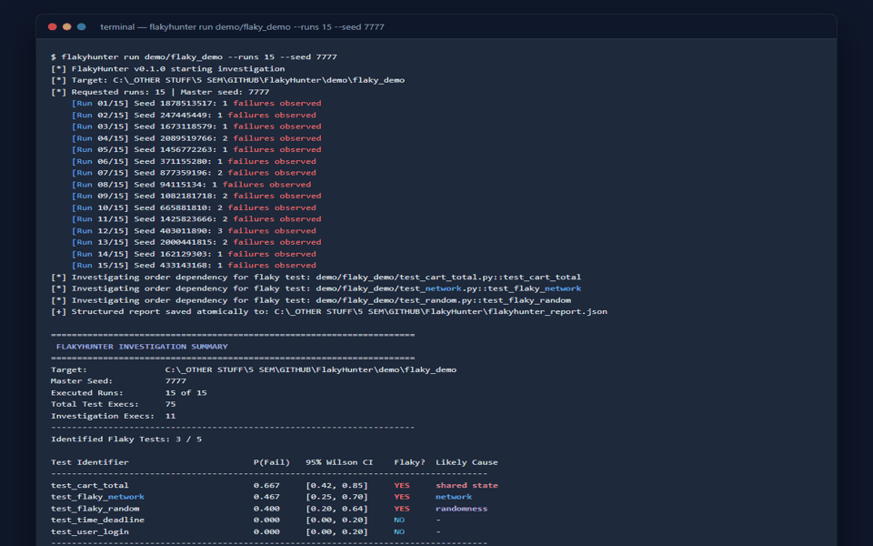
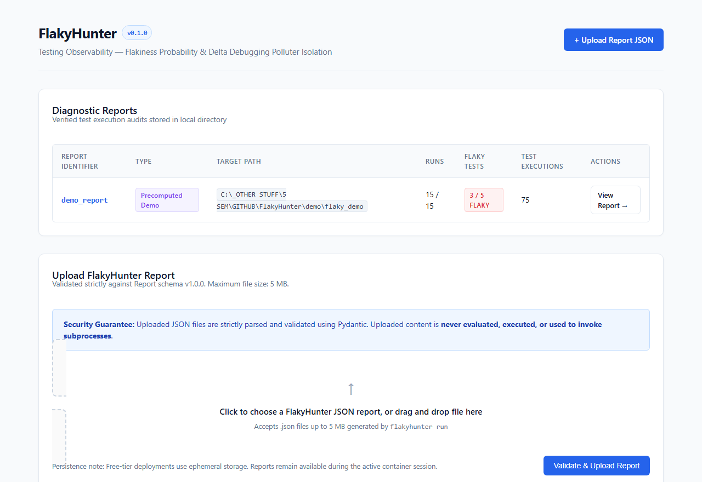
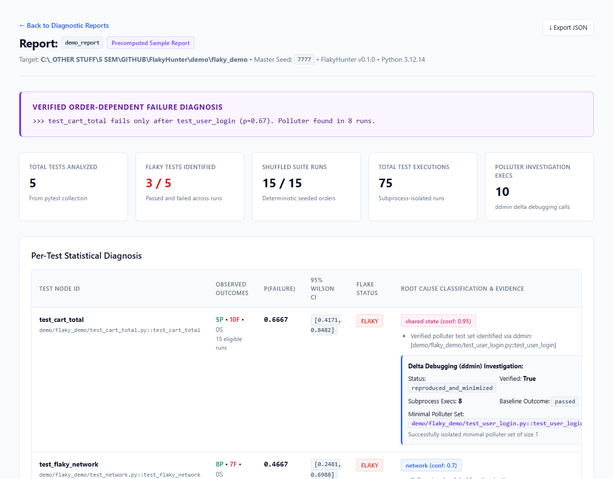
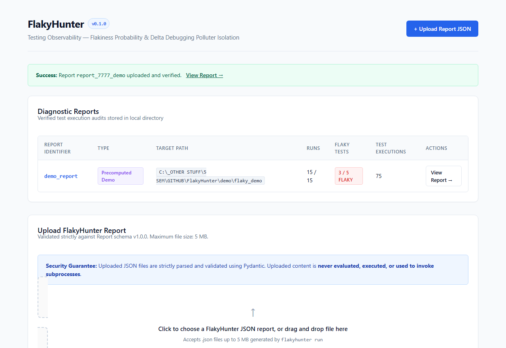
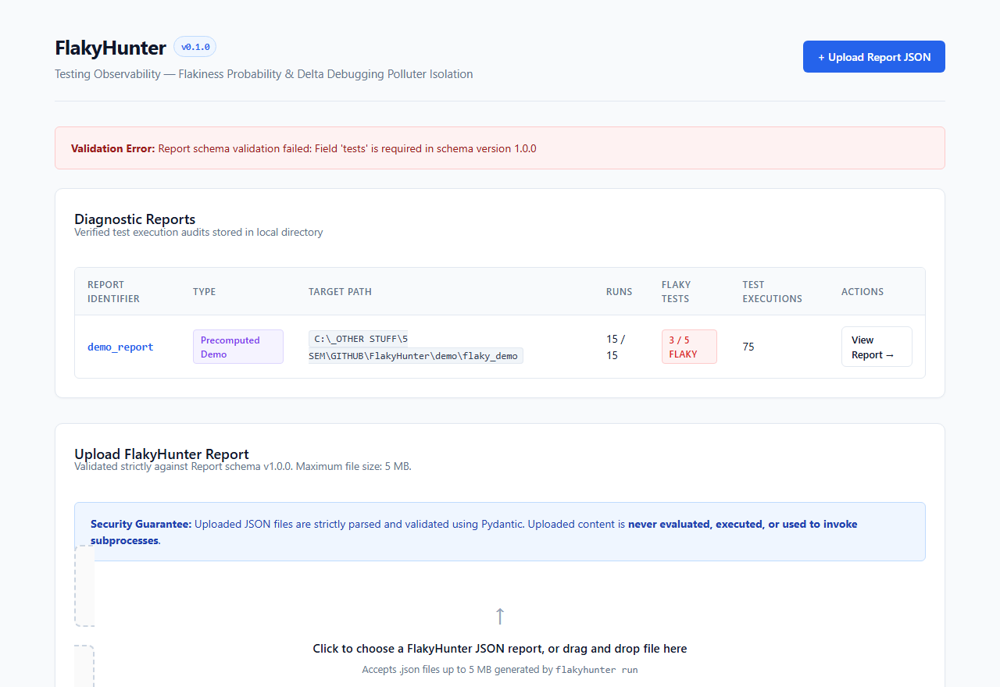
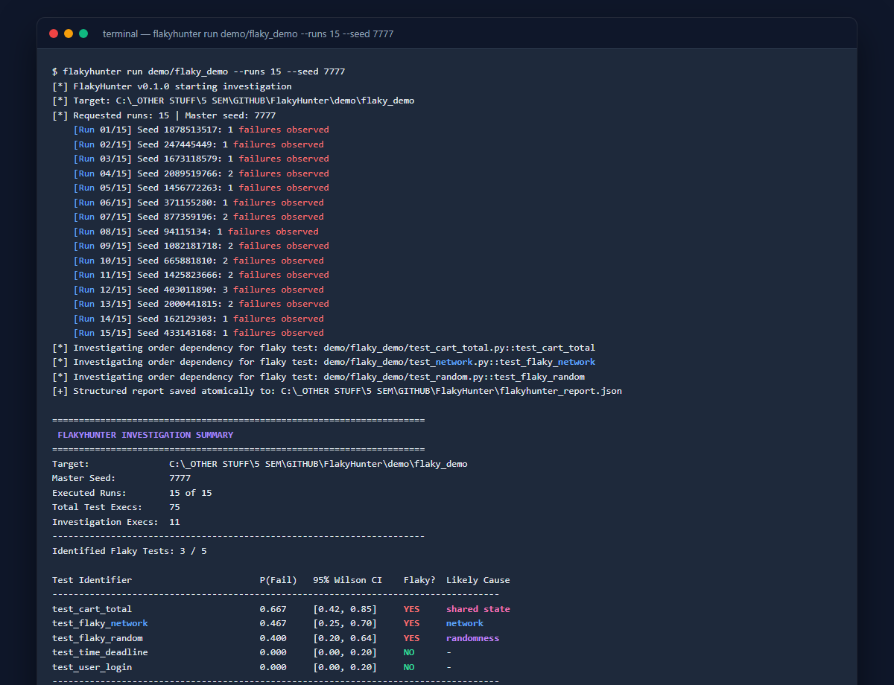
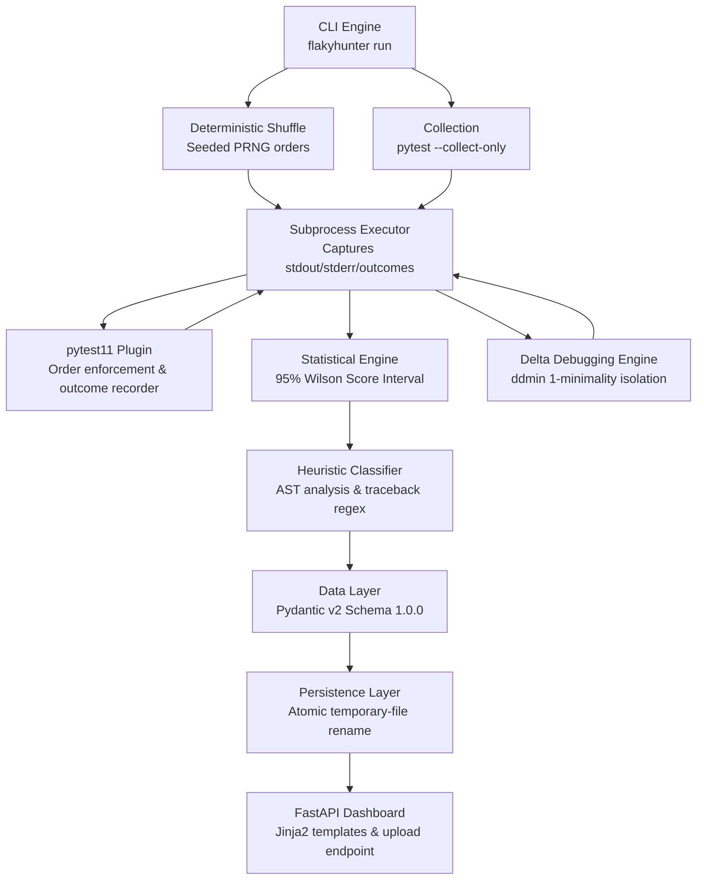

# FlakyHunter

> **Production-grade test observability for pytest suites** &mdash; detects flaky tests across reproducible shuffled orders, computes 95% Wilson score confidence intervals, isolates order-dependent polluter test sets via Andreas Zeller's delta debugging (`ddmin`), and serves an interactive diagnostic dashboard.

[](https://github.com/Vikaspatel088/FlakyHunter/actions)
[](https://www.python.org/downloads/)
[](LICENSE)
[](https://github.com/astral-sh/ruff)
[](https://docs.pytest.org/)

---

## Overview

Flaky tests pass or fail stochastically without any code changes, silently degrading developer velocity, eroding CI trust, and masking real regressions. The most pernicious class &mdash; **order-dependent failures** &mdash; only fail when specific predecessor tests pollute shared in-memory or external state.

### Problem &rarr; Solution

1. **The Problem:** Rerunning a flaky test in isolation often masks order-dependent bugs because the state polluter wasn't in the execution sequence.
2. **The FlakyHunter Engine:** Runs test suites across deterministic, reproducible pseudo-random shuffles, isolating outcomes per subprocess.
3. **The Diagnostic Verdict:** Computes rigorous Wilson binomial confidence intervals and runs Andreas Zeller's delta debugging (`ddmin`) to isolate the exact, 1-minimal polluter set in minimal executions.

---

## Interactive Workflow Demo



---

## Visual Tour

### Diagnostic Observability Dashboard
The web dashboard lists all stored execution audits, breakdown metrics, and real-time status.



### Deep-Dive Report & Polluter Isolation
Detailed statistical breakdown displaying 95% Wilson confidence intervals, AST cause heuristics, and verified `ddmin` polluter minimization.



### Verified Report Uploads & Validation
Upload JSON test reports securely. Files are streamed in 64 KB chunks, checked against a 5 MB boundary, and validated strictly against Pydantic schema v1.0.0.

| Upload Success Confirmation | Strict Schema Validation Rejection |
|:---:|:---:|
|  |  |

### CLI Terminal Execution
High-speed terminal runner executing 15 seeded shuffled orders with colored summary and WOW line output.



---

## Architecture

FlakyHunter operates as a modular, subprocess-isolated test engine:



See [`docs/architecture.md`](docs/architecture.md) for module-by-module design specifications.

---

## Technology Stack

| Component | Technology | Rationale |
|-----------|------------|-----------|
| **Core Runtime** | Python 3.11+ (tested on 3.11, 3.12, 3.13) | Standard enterprise Python runtime |
| **Test Framework** | `pytest>=8.0.0` | Industry-standard Python testing ecosystem |
| **Plugin Interface** | `pytest11` entry-point | Seamless zero-configuration integration |
| **Statistics** | Wilson Score Binomial Interval | Valid when $k=0$ or $k=n$; avoids naive Wald interval failure |
| **Algorithm** | Andreas Zeller's `ddmin` (1999) | Polynomial-time isolation of 1-minimal failure-inducing subsets |
| **Web Server** | FastAPI + Uvicorn + Jinja2 | Async high-performance dashboard without bloated frontend dependencies |
| **Validation** | Pydantic v2 | Strict JSON schema enforcement on every report |
| **Linter & Formatter** | Ruff | Sub-millisecond linting and code formatting |
| **CI Pipeline** | GitHub Actions | Automated multi-version matrix builds |

---

## Quick Start

### 1. Clone & Install

```bash
# Clone the repository
git clone https://github.com/Vikaspatel088/FlakyHunter.git
cd FlakyHunter

# Create and activate virtual environment
python -m venv .venv

# On Windows PowerShell:
.\.venv\Scripts\Activate.ps1
# On Linux / macOS:
# source .venv/bin/activate

# Install in editable mode with development tools
pip install setuptools wheel
pip install -e ".[dev]" --no-build-isolation
```

### 2. Verify in Three Commands

```bash
# 1. Check CLI version
flakyhunter --version

# 2. Run investigation against the seeded demo suite
flakyhunter run demo/flaky_demo --runs 15 --seed 7777 --output sample_results/demo_report.json

# 3. Launch interactive web dashboard
flakyhunter serve --reports-dir sample_results --port 8080
```

Open `http://localhost:8080` in your browser.

---

## CLI Usage Guide

### Basic Flakiness Detection

```bash
# Run test suite 10 times with deterministic seed 42
flakyhunter run tests/ --runs 10 --seed 42

# Export structured, validated JSON report
flakyhunter run tests/ --runs 20 --seed 1234 --output report.json

# Configure maximum subprocess budget for delta debugging
flakyhunter run tests/ --runs 15 --seed 99 --max-investigation-budget 30
```

### Dashboard Server

```bash
# Serve reports directory on custom host and port
flakyhunter serve --reports-dir sample_results --host 127.0.0.1 --port 8000
```

---

## Representative Terminal Output

Captured from executing `flakyhunter run demo/flaky_demo --runs 15 --seed 7777`:

```text
[*] FlakyHunter v0.1.0 starting investigation
[*] Target: demo/flaky_demo
[*] Requested runs: 15 | Master seed: 7777
    [Run 01/15] Seed 1878513517: 1 failures observed
    [Run 02/15] Seed 247445449: 1 failures observed
    [Run 03/15] Seed 1673118579: 2 failures observed
    [Run 04/15] Seed 2089519766: 2 failures observed
    [Run 05/15] Seed 1456772263: 1 failures observed
    [Run 06/15] Seed 371155280: 1 failures observed
    [Run 07/15] Seed 877359196: 1 failures observed
    [Run 08/15] Seed 94115134: 1 failures observed
    [Run 09/15] Seed 1082181718: 2 failures observed
    [Run 10/15] Seed 665881810: 3 failures observed
    [Run 11/15] Seed 1425823666: 1 failures observed
    [Run 12/15] Seed 403011890: 2 failures observed
    [Run 13/15] Seed 2000441815: 2 failures observed
    [Run 14/15] Seed 162129303: 2 failures observed
    [Run 15/15] Seed 433143168: 0 failures observed
[*] Investigating order dependency for flaky test: demo/flaky_demo/test_cart_total.py::test_cart_total
[*] Investigating order dependency for flaky test: demo/flaky_demo/test_network.py::test_flaky_network
[*] Investigating order dependency for flaky test: demo/flaky_demo/test_random.py::test_flaky_random
[+] Structured report saved atomically to: sample_results/demo_report.json

======================================================================
 FLAKYHUNTER INVESTIGATION SUMMARY
======================================================================
Target:               demo/flaky_demo
Master Seed:          7777
Executed Runs:        15 of 15
Total Test Execs:     75
Investigation Execs:  10
----------------------------------------------------------------------
Identified Flaky Tests: 3 / 5

Test Identifier                        P(Fail)   95% Wilson CI    Flaky?  Likely Cause
------------------------------------------------------------------------------------
test_cart_total                        0.667     [0.42, 0.85]     YES     shared state
test_flaky_network                     0.467     [0.25, 0.70]     YES     network     
test_flaky_random                      0.333     [0.15, 0.58]     YES     randomness  
test_time_deadline                     0.000     [0.00, 0.20]     NO      -           
test_user_login                        0.000     [0.00, 0.20]     NO      -           
------------------------------------------------------------------------------------

 Verified Order-Dependent Findings:
  >>> test_cart_total fails only after test_user_login (p=0.67). Polluter found in 8 runs.
====================================================================================
```

---

## Statistical Rigor: Wilson Score Interval

Naive estimators calculate failure probability as $\hat{p} = k/n$. The traditional Wald confidence interval ($\hat{p} \pm z\sqrt{\hat{p}(1-\hat{p})/n}$) suffers from zero-width degradation when $k=0$ or $k=n$, claiming 100% certainty from small sample sizes.

FlakyHunter computes the **Wilson score interval**:

$$\text{CI} = \frac{\hat{p} + \frac{z^2}{2n} \pm z\sqrt{\frac{\hat{p}(1-\hat{p})}{n} + \frac{z^2}{4n^2}}}{1 + \frac{z^2}{n}}$$

where $z \approx 1.95996$ for a 95% confidence level.

**Why this matters in practice:**
If a test passes 3 times out of 3 runs ($k=0, n=3$), the Wald interval claims $P(\text{fail}) = 0 \pm 0$. The Wilson score interval correctly yields $[0.00, 0.56]$, proving that a failure probability as high as 56% remains statistically plausible.

---

## Delta Debugging (`ddmin`) for Polluter Isolation

When a victim test fails in a specific run sequence, FlakyHunter runs a 4-step investigation:

1. **Step 1 — Baseline Check:** Runs victim alone in a fresh subprocess. If it fails alone, the failure is **intrinsic**, not order-dependent.
2. **Step 2 — Reproduction Check:** Runs all candidate predecessors + victim in a fresh subprocess. Must reproduce failure.
3. **Step 3 — Subsets & Complements Partitioning:** Partitions candidates into $n$ chunks ($n=2, 4, \dots$). Tests each subset and complement.
4. **Step 4 — 1-Minimality Verification:** Verifies that:
   - $[C_{\text{min}} + \text{victim}]$ reproducibly fails across repeated executions.
   - For every single element $e \in C_{\text{min}}$, $[(C_{\text{min}} \setminus \{e\}) + \text{victim}]$ passes.

---

## Security Model

- **No Code Execution on Server:** Uploaded JSON files are parsed solely through Pydantic v2 schemas. They are never evaluated, executed, or used to invoke subprocesses.
- **Bounded Stream Reading:** Upload streams are read in 64 KB chunks and rejected immediately if total bytes exceed 5 MB (HTTP 413).
- **Safe ID Generation:** Report identifiers are server-generated (`report_<12-hex-uuid>`). Client-provided filenames are never used as filesystem destinations.
- **Path Traversal Protection:** All path resolutions verify `.is_relative_to(base_dir)`. Traversal attempts return 404 without leaking server paths or stack traces.
- **Atomic Persistence:** Reports write to temporary sibling files before an atomic OS rename, preventing corrupt or truncated files.

---

## Measured Benchmarks (Controlled Fixtures)

The following metrics were measured by executing FlakyHunter against the seeded `demo/flaky_demo` fixture on Python 3.12:

| Metric | Measured Value | Notes |
|--------|----------------|-------|
| **Target Suite** | `demo/flaky_demo` (5 tests) | Injected: state pollution, stochastic RNG, network timeout, deadline jitter |
| **Runs & Seed** | 15 runs, seed `7777` | Reproducible deterministic shuffle |
| **Total Test Executions** | 75 | Exactly 15 runs &times; 5 tests |
| **Observed Flaky Tests** | 3 of 5 | `test_cart_total`, `test_flaky_network`, `test_flaky_random` |
| **Isolated Polluter** | `test_user_login` &rarr; `test_cart_total` | Minimal polluter set of size 1 identified |
| **ddmin Subprocess Calls** | 8 | Discovered and verified 1-minimality in 8 runs |
| **Total Investigation Execs** | 10 | 8 (cart) + 1 (network baseline) + 1 (random baseline) |
| **Wall-Clock Duration** | ~28 seconds | Subprocess-isolated test execution |

> **Honest Scope Notice:** No evaluation against external open-source repositories has been performed. These metrics demonstrate correctness on controlled reference fixtures.

---

## Deployment (Render Free Tier)

FlakyHunter includes an active [`render.yaml`](render.yaml) configuration for automated deployment to Render's free tier.

- **Start Command:**
  ```bash
  python -c "import os; port=os.environ.get('PORT','8000'); from flakyhunter.web import create_app; import uvicorn; app=create_app(reports_dir='sample_results'); uvicorn.run(app, host='0.0.0.0', port=int(port))"
  ```
- **Health Check Endpoint:** `/health`
- **Storage Lifecycle:** Render's free tier uses ephemeral container storage. Uploaded reports remain accessible throughout the active container instance lifetime. For durable multi-instance storage, connect an S3 or R2 bucket.

---

## Verification & Testing

The FlakyHunter test suite comprises 29 unit and end-to-end integration tests:

```bash
# Run Ruff linting
ruff check src/ tests/ demo/

# Run Ruff format check
ruff format --check src/ tests/ demo/

# Run full test suite with verbose output
pytest -v --tb=short
```

Current test suite status:
```text
tests/integration/test_demo_detection.py ..     [  6%]
tests/integration/test_upload_workflow.py .     [ 10%]
tests/unit/test_heuristics.py ......            [ 31%]
tests/unit/test_polluter.py ........            [ 58%]
tests/unit/test_probability.py ........         [ 86%]
tests/unit/test_time_scenario.py ....           [100%]

======================== 29 passed in 20.53s ========================
```

---

## What I Learned Building FlakyHunter

1. **Subprocess Isolation vs Shared State:** Testing order-dependent flakes requires running predecessor candidates and the victim within the *same* subprocess, while isolating each shuffled suite run in a *fresh* subprocess.
2. **The Pitfall of Wald Intervals:** Wald confidence intervals fail catastrophically on small sample sizes with zero failures. Wilson score intervals provide mathematically sound lower and upper bounds even at $k=0$.
3. **Delta Debugging Efficiency:** Andreas Zeller's `ddmin` partitions candidates logarithmically, finding 1-minimal polluters in $O(n \log n)$ rather than naive $O(2^n)$ brute-force subset enumeration.

---

## Roadmap

- [ ] Multi-core parallel execution with `pytest-xdist` integration
- [ ] Aggregation across multi-run GitHub Actions CI matrices
- [ ] S3 / Cloudflare R2 pluggable storage adapter for persistent cloud deployments
- [ ] Automated git bisect integration to isolate the commit introducing flakiness

---

## License

MIT License &mdash; Copyright &copy; 2026 **Vikas Kumar Patel**. See [LICENSE](LICENSE) for details.
