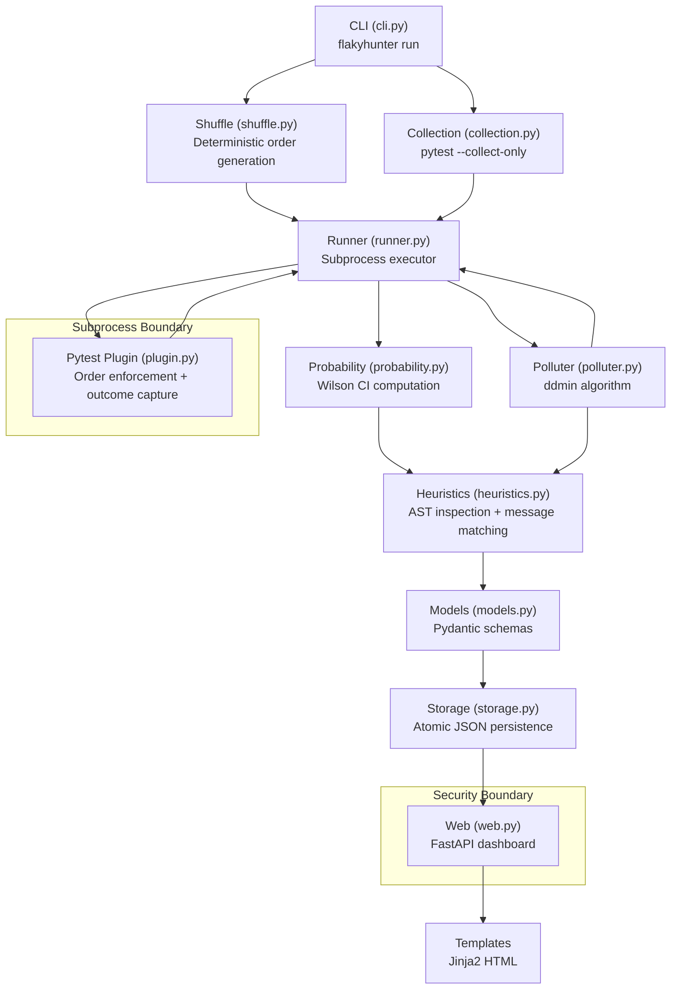

# FlakyHunter Architecture

## System Overview

FlakyHunter is a pytest plugin and CLI tool that detects flaky tests, estimates their failure probability using Wilson score confidence intervals, and isolates minimal polluter sets via delta debugging (ddmin).

## Architecture Diagram



## Module Responsibilities

| Module | Responsibility |
|--------|---------------|
| `cli.py` | Argument parsing, orchestration of the full run pipeline |
| `collection.py` | Collects test node IDs via `pytest --collect-only` subprocess |
| `shuffle.py` | Generates reproducible shuffled orders using seeded RNG |
| `runner.py` | Executes ordered test sequences in isolated subprocesses |
| `plugin.py` | pytest11 entry-point; enforces order and captures per-test outcomes |
| `probability.py` | Computes failure probability and Wilson 95% CI |
| `polluter.py` | Implements genuine ddmin; finds minimal polluter sets |
| `heuristics.py` | Classifies flake causes via AST inspection and error message matching |
| `models.py` | Pydantic v2 schema for all data types |
| `storage.py` | Atomic JSON writes; path-traversal-safe report storage |
| `reporting.py` | Terminal summary and WOW line formatting |
| `web.py` | FastAPI app: report listing, viewing, secure upload |

## Key Design Decisions

### Subprocess Isolation for Ordering
Each run executes as a separate `pytest` subprocess with `--flakyhunter-order-file` and `--flakyhunter-output-file` flags. This preserves process-level shared-state pollution effects, which is required for order-dependent investigation to work correctly.

**Caveat**: Each subprocess starts fresh Python state, so pollution that relies on persistent in-process global variables will manifest correctly only when the polluter and victim run in the *same* subprocess invocation. FlakyHunter achieves this for the polluter investigation by running `[polluters + victim]` in a single subprocess.

### ddmin Algorithm
The `run_ddmin` function in `polluter.py` implements Andreas Zeller's ddmin. Starting from the full candidate set, it repeatedly splits into subsets and tests whether failure reproduces in each subset or complement. Iteration terminates when no further reduction is possible (1-minimal condition) or the execution budget is exhausted.

### Wilson Score Confidence Interval
For test $i$ with $n$ eligible runs (passes + failures) and $k$ failures:

$$p = \frac{k}{n}, \quad \text{CI}_{95\%} = \frac{p + \frac{z^2}{2n} \pm z\sqrt{\frac{p(1-p)}{n} + \frac{z^2}{4n^2}}}{1 + \frac{z^2}{n}}$$

where $z \approx 1.96$ for 95% confidence. This interval is valid even for $p = 0$ or $p = 1$.

### Upload Security
- File extension must be `.json`
- Maximum size: 5MB
- Content is validated against the Pydantic `Report` schema before storage
- Uploaded content is **never executed** — no `eval`, `exec`, `subprocess`, or dynamic import
- Stored under a UUID-based filename; user-provided filenames are not used as filesystem paths

## Execution Flow

```
flakyhunter run demo/flaky_demo --runs 10 --seed 42
    ↓
1. Collect test node IDs (subprocess: pytest --collect-only)
2. Generate 10 deterministic shuffled orders
3. For each order:
   a. Write order to temp JSON file
   b. Run pytest subprocess with --flakyhunter-order-file
   c. Plugin enforces order, captures per-test outcomes
   d. Plugin writes outcomes to temp JSON file
   e. Runner reads outcomes → RunRecord
4. Aggregate outcomes per test → TestSummary with Wilson CI
5. For each flaky test:
   a. Check baseline (victim alone): must PASS
   b. Check reproduction (candidates + victim): must FAIL
   c. Run ddmin on candidates
   d. Verify 1-minimality of result
6. Classify cause for each flaky test
7. Build Report → save atomically to output.json
8. Print terminal summary + WOW lines
```
